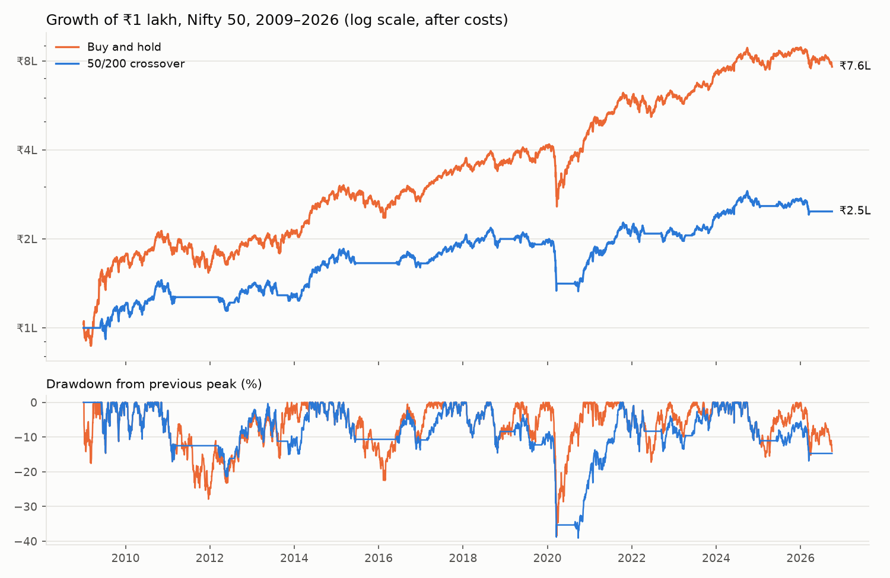
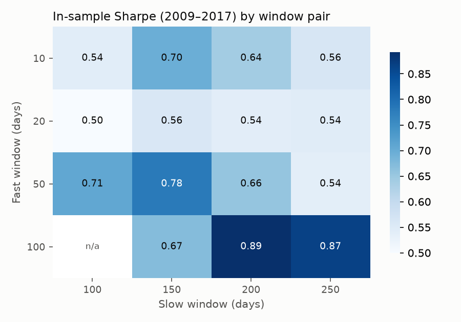

# Nifty 50 moving-average crossover backtest

Does the classic 50/200-day moving-average crossover beat simply holding the
Nifty 50? This is a small daily backtester built to answer that carefully:
trading costs, a realistic execution delay, an out-of-sample check, and tests
that prove the engine can't see the future.

**Short answer: no.** From 2009 to September 2026 the crossover returned 5.2% a
year against 12.1% for buy and hold, and it did not reduce the worst loss.



| 2009-01-01 to 2026-09-30 | CAGR | Volatility | Sharpe | Max drawdown | Time invested | Trades |
|---|---:|---:|---:|---:|---:|---:|
| Buy and hold | 12.1% | 18.0% | 0.75 | -38.4% | 100% | 0 |
| 50/200 crossover | 5.2% | 13.0% | 0.47 | -39.1% | 71% | 24 |

10 bps cost per buy or sell, trades one day after the signal, no interest on
cash. Full tables, including the sensitivity runs: [results/summary.md](results/summary.md).

## Findings

- **Lower risk, but much lower return.** The crossover is out of the market 29%
  of the time, which cuts volatility from 18% to 13%, but it gives up more
  return than risk: Sharpe 0.47 vs 0.75.
- **It did not protect against the biggest crash.** It sold at the close of
  20 March 2020 (Nifty 8,745), one trading day before the COVID low, and only
  bought back on 24 August 2020 at 11,466, 31% higher. Together with
  whipsaw trades in 2018–19, its worst drawdown (-39.1%) was slightly *worse*
  than buy and hold's (-38.4%). A slow trend signal reacts after a fast crash
  has already happened.
- **The in-sample winner did not survive out of sample.** Choosing the windows
  on 2009–2017 data picks 100/200, which beats buy and hold on that period
  (Sharpe 0.89 vs 0.86). On 2018–2026 the same rule falls to 0.26 vs 0.61,
  no better than the untuned 50/200. The in-sample edge was fitting noise.

  

- **Costs barely matter here; the cash assumption matters more.** With only 24
  trades in 17 years, moving costs from 0 to 25 bps changes CAGR by 0.4 points.
  Earning 6% a year on cash while out of the market lifts CAGR from 5.2% to
  7.0%, still well short of buy and hold.

## How the backtest avoids common mistakes

| Mistake | What this project does |
|---|---|
| Look-ahead bias | A signal computed from the close on day *t* is traded at the close of day *t+1* (configurable). A test changes every price from day *k* onward and checks that the position held on day *k* and all earlier results stay identical. Deliberately breaking the engine (trading on the same close) makes the tests fail. |
| Ignoring costs | 10 bps of capital per buy and per sell, with 0 and 25 bps as sensitivity runs. |
| Unfair comparison | Both strategies are measured over the same dates, starting in 2009 once every moving-average window has enough history. |
| Overfitting | Window pairs are chosen on 2009–2017 only, then judged on 2018–2026. |
| Bad data | Prices are checked for gaps, duplicates, missing values and implausible one-day moves before use. The Nifty ETF (`NIFTYBEES.NS`) fails this check: Yahoo's data shows -90% on 19 Dec 2019 and +897% two trading days later, which looks like a botched split adjustment. That is why this project uses the index. |
| Unreproducible results | Data is cached to `data/` with a fixed end date, so every run gives the same numbers. |

## Limitations

- **The index isn't directly tradable.** A real Nifty ETF adds an expense ratio
  and tracking error.
- **Dividends are excluded.** `^NSEI` is a price index. Dividends would add
  roughly 1–1.5% a year while invested, which helps buy and hold more than the
  crossover. The total-return index would be the fairer comparison.
- **Taxes are ignored.** Each crossover sale realises capital gains; buy and
  hold defers them. This would widen the gap.
- **The scope is narrow.** One index, one family of rules and one in-sample /
  out-of-sample split. The Sharpe ratio uses a zero risk-free rate.

## Run it

Needs [uv](https://docs.astral.sh/uv/).

```bash
uv sync
uv run pytest
uv run python run.py
```

`run.py` writes `results/summary.md` and both charts. Use
`uv run python run.py --refresh` to download the data again.

## Layout

```
backtest/
  data.py       download, cache and validate prices
  strategy.py   moving-average crossover and buy-and-hold signals
  engine.py     signal -> daily returns, with delay, costs and cash yield
  metrics.py    CAGR, volatility, Sharpe, drawdown
run.py          runs every experiment and writes results/
tests/          17 tests: look-ahead, timing, costs, metrics, data checks
```
